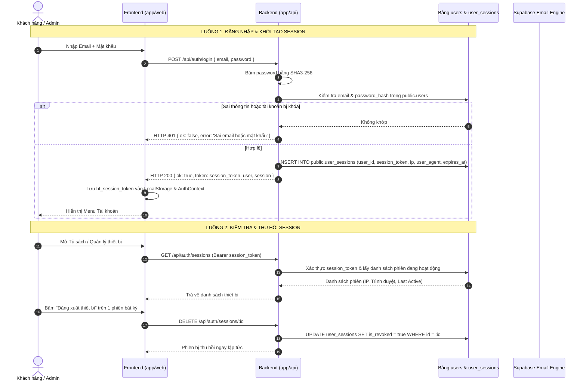
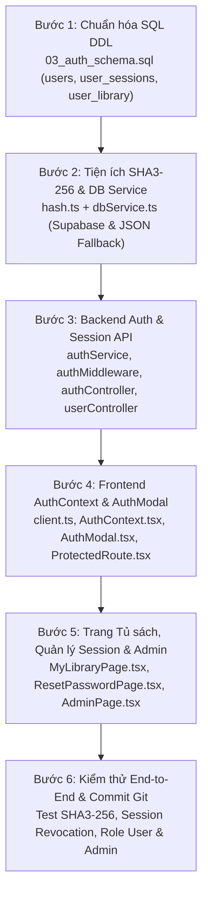

# KẾ HOẠCH TOÀN DIỆN: TRIỂN KHAI HỆ THỐNG XÁC THỰC, QUẢN LÝ SESSION & PHÂN QUYỀN (ROLE USER & ADMIN)
## KIẾN TRÚC HYBRID TỰ CHỦ: BẢNG `public.users` + `public.user_sessions` (BĂM SHA3-256) & SUPABASE EMAIL GATEWAY

> **Mã tài liệu:** `05-ke-hoach-trien-khai-dang-nhap-va-phan-quyen-user-admin.md`  
> **Dự án:** Hệ thống thương mại điện tử tài liệu giáo dục Huy Tutor (`huytutor.edu.vn`)  
> **Phiên bản:** 3.0 (Kiến trúc Tự chủ hoàn toàn - SHA3-256 & Quản lý Session tập trung)  
> **Trạng thái:** Đã triển khai kỹ thuật (Production Ready)  
> **Nguyên tắc cốt lõi:**  
> 1. **Toàn bộ dữ liệu tài khoản, phiên đăng nhập (Session), phân quyền (`user` / `admin`) và tủ sách nằm trong các bảng riêng `public.users`, `public.user_sessions`, `public.user_library`**, không phụ thuộc vào bảng nội bộ `auth.users` của Supabase.  
> 2. **Backend (`app/api`) tự băm mật khẩu bằng thuật toán `sha3-256` (`crypto.createHash('sha3-256')`)** và quản lý vòng đời phiên đăng nhập (`session_token`) trực tiếp trong cơ sở dữ liệu.  
> 3. **Tận dụng hạ tầng Supabase làm Cổng gửi Email (Email Gateway)** cho chức năng Quên mật khẩu mà không cần mua dịch vụ email thứ 3.  
> 4. **100% luồng dữ liệu bắt buộc đi qua Backend API (`app/api`)**, Frontend tuyệt đối không kết nối trực tiếp vào Database.

---

## MỤC LỤC

1. [TỔNG QUAN KIẾN TRÚC & MÔ HÌNH HYBRID TỰ CHỦ](#1-tổng-quan-kiến-trúc--mô-hình-hybrid-tự-chủ)
   - 1.1. Tại sao tự quản lý bảng `public.users` & `public.user_sessions` vượt trội hơn `auth.users`?
   - 1.2. Thuật toán băm `sha3-256` & Cơ chế Quản lý Session trạng thái (Stateful Session Management)
   - 1.3. Cách thức Supabase đóng vai trò Cổng gửi Email (Email Gateway)
   - 1.4. Mô hình Phân quyền RBAC (Role-Based Access Control: `user` & `admin`)
   - 1.5. Sơ đồ tuần tự Xác thực, Quản lý Session & Gửi Email (Sequence Diagram)
2. [THIẾT KẾ CƠ SỞ DỮ LIỆU THUẦN TÚY (`public.users` & `public.user_sessions`)](#2-thiết-kế-cơ-sở-dữ-liệu-thuần-túy-publicusers--publicuser_sessions)
   - 2.1. Cấu trúc bảng `public.users` & `public.user_sessions`
   - 2.2. Bảng Tủ sách cá nhân `public.user_library` & Cột `orders.user_id`
   - 2.3. Trigger tự động nạp tài liệu vào Tủ sách khi đơn hàng thanh toán thành công
   - 2.4. Mã nguồn SQL DDL hoàn chỉnh (`03_auth_schema.sql`)
   - 2.5. Khởi tạo tài khoản Admin ban đầu
3. [THIẾT KẾ & TRIỂN KHAI BACKEND API (`app/api`)](#3-thiết-kế--triển-khai-backend-api-appapi)
   - 3.1. Tiện ích băm `sha3-256` & Sinh mã ngẫu nhiên (`hash.ts`)
   - 3.2. Dịch vụ Xác thực & Quản lý Phiên (`authService.ts`)
   - 3.3. Tích hợp gửi Email qua Supabase Admin API (`supabase.auth.admin.generateLink`)
   - 3.4. Các Middlewares xác thực Session (`authMiddleware`, `optionalAuth`, `adminAuth`)
   - 3.5. Danh mục RESTful API Endpoints
4. [THIẾT KẾ & TRIỂN KHAI FRONTEND WEB APP (`app/web`)](#4-thiết-kế--triển-khai-frontend-web-app-appweb)
   - 4.1. Quản lý trạng thái đăng nhập & Session toàn cục (`AuthContext.tsx`)
   - 4.2. Bảo vệ Route bằng `<ProtectedRoute />`
   - 4.3. Thành phần giao diện Đăng nhập / Đăng ký / Quên mật khẩu (`AuthModal.tsx`)
   - 4.4. Nâng cấp Thanh điều hướng (`Header.tsx`): Dropdown Profile & Quyền Admin
   - 4.5. Trang Tủ sách cá nhân & Quản lý Phiên đăng nhập (`MyLibraryPage.tsx` / `/my-library`)
   - 4.6. Trang Đặt lại mật khẩu (`ResetPasswordPage.tsx` / `/reset-password`)
   - 4.7. Tích hợp tự động điền form mua hàng (`CheckoutModal.tsx`) & Quản trị thành viên (`AdminPage.tsx`)
5. [LỘ TRÌNH THỰC THI 6 BƯỚC (STEP-BY-STEP PLAYBOOK)](#5-lộ-trình-thực-thi-6-bước-step-by-step-playbook)
6. [CHECKLIST AN TOÀN THÔNG TIN & KIỂM THỬ TRƯỚC KHI GIAO VIỆC](#6-checklist-an-toàn-thông-tin--kiểm-thử-trước-khi-giao-việc)

---

## 1. TỔNG QUAN KIẾN TRÚC & MÔ HÌNH HYBRID TỰ CHỦ

### 1.1. Tại sao tự quản lý bảng `public.users` & `public.user_sessions` vượt trội hơn `auth.users`?

```
┌────────────────────────────────────────────────────────────────────────────────────────┐
│                               KIẾN TRÚC HYBRID TỰ CHỦ                                  │
├─────────────────────────────────────────────────┬──────────────────────────────────────┤
│    BACKEND & DATABASE HUY TUTOR (TỰ CHỦ 100%)   │   SUPABASE INFRASTRUCTURE (TIỆN ÍCH)  │
├─────────────────────────────────────────────────┼──────────────────────────────────────┤
│ • Bảng public.users (Lưu email, password_hash   │ • Cổng gửi Email (Email Gateway)     │
│   SHA3-256, role 'admin' | 'user', họ tên...)   │ • Gửi link đặt lại mật khẩu tự động  │
│ • Bảng public.user_sessions (Quản lý phiên,     │ • Không tốn chi phí mua dịch vụ      │
│   IP, thiết bị, thu hồi phiên từ xa tức thì)    │   email bên ngoài (SendGrid, Mailgun)│
│ • Bảng public.user_library (Tủ sách trọn đời)   │                                      │
│ • Băm mật khẩu chuẩn SHA3-256 (Node.js crypto)  │                                      │
│ • Chạy offline mượt mà với local_db.json        │                                      │
└─────────────────────────────────────────────────┴──────────────────────────────────────┘
```

1. **Làm chủ hoàn toàn dữ liệu & Zero Vendor Lock-in:**
   - Toàn bộ tài khoản (`public.users`), phiên đăng nhập (`public.user_sessions`), và tủ sách (`public.user_library`) nằm trong schema `public` chuẩn PostgreSQL.
2. **Thuật toán băm `sha3-256` tốc độ cao, không phụ thuộc thư viện C++ bên ngoài:**
   - Sử dụng trực tiếp module `crypto` nguyên bản của Node.js: `crypto.createHash('sha3-256').update(password).digest('hex')` tạo ra chuỗi băm 64 ký tự hex đồng nhất.
3. **Kiểm soát Session thời gian thực (Stateful Session Management):**
   - Mỗi lần đăng nhập tạo một dòng trong `public.user_sessions` kèm `session_token`, địa chỉ IP, trình duyệt (`user_agent`), thời gian hoạt động cuối (`last_active_at`) và hạn dùng (`expires_at`).
   - Người dùng hoặc Admin có thể xem danh sách các thiết bị đang đăng nhập và **thu hồi (revoke/logout) bất kỳ phiên nào ngay lập tức** (điều mà stateless JWT thông thường không làm được).

---

### 1.2. Thuật toán băm `sha3-256` & Cơ chế Quản lý Session

- **Chuỗi băm mật khẩu (`sha3-256`):**
  - Công thức: `SHA3-256(password) -> 64 hex chars`.
  - Ví dụ mật khẩu Admin khởi tạo `Admin@123` có giá trị băm `sha3-256`:
    `8e6b8cb7aa0ce9ec3c88a50e42cc9bb51c4aa62fd0fc2a3139fbf713ec7d6eda`
- **Vòng đời Phiên đăng nhập (`user_sessions`):**
  1. **Khởi tạo phiên (Login / Register):** Sinh `session_token` 64 ký tự hex ngẫu nhiên (`crypto.randomBytes(32).toString('hex')`), thời hạn 7 ngày (`expires_at = NOW() + 7 days`), lưu kèm `ip_address` và `user_agent`.
  2. **Xác thực mỗi Request (`authMiddleware`):** Đọc header `Authorization: Bearer <session_token>`, kiểm tra trong `user_sessions` xem phiên có tồn tại, `is_revoked = false`, `expires_at > NOW()` và tài khoản `is_active = true` hay không. Nếu hợp lệ, cập nhật `last_active_at = NOW()`.
  3. **Thu hồi phiên (Logout / Kick thiết bị):**
     - Đăng xuất thiết bị hiện tại: Đặt `is_revoked = true` cho `session_token` hiện tại.
     - Đăng xuất khỏi thiết bị khác: Đặt `is_revoked = true` theo `sessionId`.
     - Đăng xuất toàn bộ thiết bị (hoặc khi đổi mật khẩu): Đặt `is_revoked = true` cho toàn bộ phiên của `user_id`.

---

### 1.3. Cách thức Supabase đóng vai trò Cổng gửi Email (Email Gateway)

1. Khi khách bấm **"Quên mật khẩu"**:
   - Backend sinh `reset_password_token` và lưu vào `public.users` kèm hạn 15 phút.
   - Backend gọi `supabaseAdmin.auth.admin.generateLink` (`type: 'recovery'`) trỏ về `https://huytutor.edu.vn/reset-password?token=<reset_password_token>`.
2. Khách bấm vào link trong email $\rightarrow$ Mở trang `/reset-password` $\rightarrow$ Nhập mật khẩu mới $\rightarrow$ Backend băm mật khẩu mới bằng `sha3-256`, cập nhật vào `public.users` và thu hồi toàn bộ các phiên cũ.

---

### 1.4. Mô hình Phân quyền RBAC (Role-Based Access Control: `user` & `admin`)

| Quyền hạn hệ thống | Khách vãng lai (Guest) | Khách hàng (`user`) | Quản trị viên (`admin`) |
| :--- | :---: | :---: | :---: |
| Xem catalog, đọc thử có watermark | ✅ | ✅ | ✅ |
| Đặt hàng & quét VietQR thanh toán | ✅ | ✅ (Tự điền form 1 chạm) | ✅ |
| Đăng ký tài khoản / Đăng nhập / Đổi mật khẩu | ✅ | ✅ | ✅ |
| **Quản lý Phiên đăng nhập & Thiết bị (`Sessions`)** | ❌ | ✅ | ✅ |
| **Truy cập Tủ sách cá nhân (`/my-library`)** | ❌ (Chuyển sang login) | ✅ (Chỉ tài liệu đã mua) | ✅ |
| Quản lý thông tin xuất hóa đơn VAT mặc định | ❌ | ✅ | ✅ |
| **Truy cập Trang Quản trị (`/admin`)** | ❌ (403 Forbidden) | ❌ (403 Forbidden) | ✅ |
| Thêm/Sửa/Xóa tài liệu, Upload R2, Đóng dấu PDF | ❌ | ❌ | ✅ |
| Xem toàn bộ đơn hàng & Bắn lại Google Form | ❌ | ❌ | ✅ |
| **Quản lý danh sách thành viên, Đổi Role & Thu hồi Session** | ❌ | ❌ | ✅ |

---

### 1.5. Sơ đồ tuần tự Xác thực, Quản lý Session & Gửi Email (Sequence Diagram)



---

## 2. THIẾT KẾ CƠ SỞ DỮ LIỆU THUẦN TÚY (`public.users` & `public.user_sessions`)

### 2.1. Cấu trúc bảng `public.users` & `public.user_sessions`

```
┌────────────────────────────────────────────────────────┐
│                      public.users                      │
├────────────────────────────────────────────────────────┤
│ id (UUID, PK, DEFAULT gen_random_uuid())               │
│ email (VARCHAR(255), UNIQUE, NOT NULL)                 │
│ password_hash (VARCHAR(64), NOT NULL) -- SHA3-256 hex  │
│ full_name (VARCHAR(255), NOT NULL)                     │
│ phone (VARCHAR(50), DEFAULT '')                        │
│ role (VARCHAR(20), NOT NULL, DEFAULT 'user')           │ <-- 'user' | 'admin'
│ customer_group (VARCHAR(50), DEFAULT 'Giáo viên')      │
│ school_or_org (TEXT, DEFAULT '')                       │
│ default_tax_cccd (VARCHAR(50), DEFAULT '')             │
│ default_invoice_address (TEXT, DEFAULT '')             │
│ reset_password_token (VARCHAR(255), NULL)              │
│ reset_password_expires_at (TIMESTAMPTZ, NULL)          │
│ is_active (BOOLEAN, DEFAULT true)                      │
│ last_login_at (TIMESTAMPTZ, NULL)                      │
│ created_at / updated_at (TIMESTAMPTZ)                  │
└─────────────┬────────────────────────────┬─────────────┘
              │ 1 : N                      │ 1 : N
┌─────────────┴──────────────────────┐ ┌───┴───────────────────────────────────┐
│       public.user_sessions         │ │          public.user_library          │
├────────────────────────────────────┤ ├───────────────────────────────────────┤
│ id (UUID, PK)                      │ │ id (UUID, PK)                         │
│ user_id (UUID, FK -> users.id)     │ │ user_id (UUID, FK -> users.id)        │
│ session_token (VARCHAR(128), UNIQ) │ │ order_id (TEXT, FK -> orders.id)      │
│ user_agent (TEXT)                  │ │ order_code (VARCHAR(32))              │
│ ip_address (VARCHAR(64))           │ │ product_slug (TEXT)                   │
│ is_revoked (BOOLEAN, DEFAULT false)│ │ product_title (TEXT)                  │
│ expires_at (TIMESTAMPTZ)           │ │ format_code (TEXT)                    │
│ last_active_at (TIMESTAMPTZ)       │ │ access_drive_url (TEXT)               │
│ created_at (TIMESTAMPTZ)           │ │ granted_at (TIMESTAMPTZ)              │
└────────────────────────────────────┘ └───────────────────────────────────────┘
```

### 2.2. Bảng Tủ sách cá nhân `public.user_library` & Cột `orders.user_id`

- Bảng `public.orders` có cột `user_id` tham chiếu tới `public.users(id)`.
- Bảng `public.user_library` lưu trữ các tài liệu và định dạng mà người dùng đã thanh toán thành công.

### 2.3. Trigger tự động nạp tài liệu vào Tủ sách khi đơn hàng thanh toán thành công

- Khi `orders.payment_status` chuyển sang `'paid'`, cả Trigger PostgreSQL (`handle_order_payment_completed`) lẫn tầng dịch vụ Backend (`dbService.markOrderPaid`) đều tự động kiểm tra `user_id` (hoặc khớp `customer_email` với `public.users.email`) để cấp quyền tài liệu vào `user_library`.

### 2.4. Mã nguồn SQL DDL hoàn chỉnh (`03_auth_schema.sql`)

Toàn bộ định nghĩa bảng, index, trigger và RLS policy được đặt tại file `app/api/sql/03_auth_schema.sql`.

### 2.5. Khởi tạo tài khoản Admin ban đầu

Tài khoản Admin mặc định được khởi tạo sẵn trong cả `03_auth_schema.sql` và dữ liệu seed dự phòng của Backend:
- **Email:** `huymdcc@gmail.com`
- **Mật khẩu mặc định:** `Admin@123`
- **Chuỗi băm `sha3-256`:** `8e6b8cb7aa0ce9ec3c88a50e42cc9bb51c4aa62fd0fc2a3139fbf713ec7d6eda`
- **Role:** `admin`

```sql
INSERT INTO public.users (email, password_hash, full_name, phone, role, customer_group, email_verified, is_active)
VALUES (
  'huymdcc@gmail.com',
  '8e6b8cb7aa0ce9ec3c88a50e42cc9bb51c4aa62fd0fc2a3139fbf713ec7d6eda',
  'Thầy Huỳnh Thanh Duy (Huy Tutor)',
  '0358999147',
  'admin',
  'Giáo viên',
  true,
  true
) ON CONFLICT (email) DO UPDATE SET role = 'admin';
```

---

## 3. THIẾT KẾ & TRIỂN KHAI BACKEND API (`app/api`)

### 3.1. Tiện ích băm `sha3-256` & Sinh mã ngẫu nhiên (`app/api/src/utils/hash.ts`)

```typescript
import crypto from 'crypto';

export function hashSha3_256(plainText: string): string {
  return crypto.createHash('sha3-256').update(plainText, 'utf8').digest('hex');
}

export function verifySha3_256(plainText: string, expectedHash: string): boolean {
  const actualHash = hashSha3_256(plainText);
  if (actualHash.length !== expectedHash.length) return false;
  return crypto.timingSafeEqual(Buffer.from(actualHash, 'utf8'), Buffer.from(expectedHash, 'utf8'));
}

export function generateSecureToken(byteLength = 32): string {
  return crypto.randomBytes(byteLength).toString('hex');
}
```

### 3.2. Dịch vụ Xác thực & Quản lý Phiên (`app/api/src/services/authService.ts`)

Bao gồm đầy đủ các hàm:
- `register`: Kiểm tra email trùng, băm mật khẩu bằng `hashSha3_256`, tạo bản ghi trong `users`, tự động khớp các đơn hàng cũ cùng email để nạp vào `user_library`, và khởi tạo phiên đăng nhập đầu tiên trong `user_sessions`.
- `login`: Kiểm tra email và `verifySha3_256(password, user.password_hash)`, tạo phiên mới trong `user_sessions` (hạn 7 ngày), trả về `token` (`session_token`), thông tin `user` và `session`.
- `validateSession`: Kiểm tra `session_token` trong `user_sessions` (`!is_revoked` và `expires_at > NOW()`), cập nhật `last_active_at`.
- `logout` / `logoutAll` / `revokeSession` / `listSessions`: Quản lý toàn diện các phiên đăng nhập của người dùng.
- `forgotPassword` / `resetPassword` / `changePassword`: Đặt lại và đổi mật khẩu bằng `sha3-256`.

### 3.3. Tích hợp gửi Email qua Supabase Admin API (`supabase.auth.admin.generateLink`)

Sử dụng `supabaseAdmin.auth.admin.generateLink` để gửi email khôi phục mật khẩu dẫn về `/reset-password?token=<resetToken>`.

### 3.4. Các Middlewares xác thực Session (`authMiddleware.ts` & `adminAuth.ts`)

- `requireAuth`: Bắt buộc có `Authorization: Bearer <session_token>` hợp lệ trong bảng `user_sessions`.
- `optionalAuth`: Đính kèm `req.user` nếu có `session_token` hợp lệ (dùng khi tạo đơn hàng để tự động gắn `user_id`).
- `adminAuthMiddleware`: Cho phép truy cập nếu `req.user.role === 'admin'` (từ `session_token`) hoặc có khóa dự phòng `x-admin-key`.

### 3.5. Danh mục RESTful API Endpoints

```
[NHÓM AUTHENTICATION & SESSION MANAGEMENT]
POST   /api/auth/register               --> Đăng ký tài khoản mới (SHA3-256) & tạo Session
POST   /api/auth/login                  --> Đăng nhập (SHA3-256) & tạo Session mới
GET    /api/auth/me                     --> Lấy thông tin tài khoản & Session hiện tại
POST   /api/auth/logout                 --> Thu hồi Session hiện tại
POST   /api/auth/logout-all             --> Thu hồi toàn bộ Session của tài khoản
GET    /api/auth/sessions               --> Danh sách các phiên/thiết bị đang đăng nhập
DELETE /api/auth/sessions/:sessionId    --> Thu hồi 1 phiên đăng nhập cụ thể từ xa
POST   /api/auth/change-password        --> Đổi mật khẩu (SHA3-256)
POST   /api/auth/forgot-password        --> Sinh mã reset & gửi Email qua Supabase
POST   /api/auth/reset-password         --> Đặt lại mật khẩu mới qua token

[NHÓM KHÁCH HÀNG - TỦ SÁCH & HỒ SƠ CÁ NHÂN]
GET    /api/user/library                --> Danh sách tài liệu đã mua trong Tủ sách cá nhân
GET    /api/user/orders                 --> Lịch sử các đơn hàng của tài khoản
PUT    /api/user/profile                --> Cập nhật hồ sơ cá nhân & thông tin xuất hóa đơn

[NHÓM QUẢN TRỊ VIÊN - ADMIN USER & SESSION MANAGEMENT]
GET    /api/admin/users                 --> Danh sách toàn bộ thành viên & số phiên hoạt động
PUT    /api/admin/users/:id/role        --> Cập nhật phân quyền ('user' <-> 'admin') & trạng thái
DELETE /api/admin/users/:id/sessions    --> Thu hồi toàn bộ phiên đăng nhập của 1 thành viên
```

---

## 4. THIẾT KẾ & TRIỂN KHAI FRONTEND WEB APP (`app/web`)

### 4.1. Quản lý trạng thái đăng nhập & Session toàn cục (`AuthContext.tsx`)

Lưu trữ `ht_session_token` trong `localStorage`, tự động đồng bộ thông tin `user` khi tải trang, hỗ trợ đăng nhập, đăng ký, đăng xuất phiên hiện tại và đăng xuất toàn bộ thiết bị.

### 4.2. Bảo vệ Route bằng `<ProtectedRoute />`

Chặn người dùng chưa đăng nhập khỏi `/my-library` và chặn tài khoản `role !== 'admin'` khỏi `/admin`.

### 4.3. Thành phần giao diện Đăng nhập / Đăng ký / Quên mật khẩu (`AuthModal.tsx`)

Thiết kế chuẩn nhận diện thương hiệu Huy Tutor (`#e60049`), bo góc `rounded-md` cho khung, `rounded-sm` cho nút bấm, nút bấm thuần chữ 100% không dùng icon/emoji.

### 4.4. Nâng cấp Thanh điều hướng (`Header.tsx`)

- Khi chưa đăng nhập: Hiển thị nút **`Đăng nhập`** và **`Đăng ký`**.
- Khi đã đăng nhập: Hiển thị tên tài khoản kèm menu truy cập nhanh **Tủ sách của tôi**, **Quản lý phiên đăng nhập**, **Trang quản trị** (chỉ hiển thị khi `role === 'admin'`), và **Đăng xuất**.

### 4.5. Trang Tủ sách cá nhân & Quản lý Phiên đăng nhập (`MyLibraryPage.tsx` / `/my-library`)

Bao gồm 4 phân khu chức năng:
1. **Tủ sách đã mua:** Lọc theo định dạng (`Tất cả`, `Word`, `PDF`, `Flashcard`), mở link tài liệu hoặc xem bản đọc thử.
2. **Lịch sử đơn hàng:** Tra cứu toàn bộ đơn hàng đã đặt gắn với tài khoản hoặc email.
3. **Phiên đăng nhập (`Sessions`):** Xem danh sách thiết bị/trình duyệt đang đăng nhập, địa chỉ IP, thời điểm hoạt động gần nhất, nút **Thu hồi phiên** từng thiết bị và **Đăng xuất tất cả thiết bị**.
4. **Hồ sơ & Hóa đơn:** Cập nhật họ tên, số điện thoại, nhóm khách hàng, đơn vị công tác, mã số thuế/CCCD xuất hóa đơn và đổi mật khẩu.

### 4.6. Trang Đặt lại mật khẩu (`ResetPasswordPage.tsx` / `/reset-password`)

Nhận `?token=...` từ đường dẫn email khôi phục để đặt lại mật khẩu mới.

### 4.7. Tích hợp tự động điền form mua hàng (`CheckoutModal.tsx`) & Quản trị thành viên (`AdminPage.tsx`)

- `CheckoutModal.tsx`: Tự động điền họ tên, email, số điện thoại, nhóm khách hàng và thông tin xuất hóa đơn từ tài khoản đang đăng nhập.
- `AdminPage.tsx`: Bổ sung tab **Quản lý Thành viên & Session** cho phép Admin xem danh sách người dùng, đổi quyền `user` $\leftrightarrow$ `admin`, khóa/mở khóa tài khoản và thu hồi toàn bộ phiên đăng nhập của người dùng.

---

## 5. LỘ TRÌNH THỰC THI 6 BƯỚC (STEP-BY-STEP PLAYBOOK)



---

## 6. CHECKLIST AN TOÀN THÔNG TIN & KIỂM THỬ TRƯỚC KHI GIAO VIỆC

| STT | Tiêu chí bảo mật & kỹ thuật | Trạng thái | Giải pháp kỹ thuật |
| :-: | :--- | :---: | :--- |
| 1 | **Bảo mật Mật khẩu** | BẮT BUỘC | Băm 1 chiều bằng `sha3-256` (`crypto.createHash('sha3-256')`) kèm so sánh chống timing attack (`timingSafeEqual`) |
| 2 | **Quản lý Session tập trung** | BẮT BUỘC | Lưu trữ trong `public.user_sessions`, hỗ trợ kiểm tra hạn dùng, theo dõi IP/User-Agent và thu hồi phiên tức thì |
| 3 | **Bảo vệ Phân quyền (RBAC)** | BẮT BUỘC | Chỉ có 2 role chuẩn: `user` và `admin`; chặn truy cập `/admin` nếu không phải `admin` |
| 4 | **Bảo vệ Dữ liệu Tủ sách** | BẮT BUỘC | Endpoint `/api/user/library` bắt buộc lọc theo `user_id` của phiên đăng nhập hiện tại |
| 5 | **Tận dụng Supabase Email** | BẮT BUỘC | Sử dụng `supabaseAdmin.auth.admin.generateLink` để gửi email khôi phục mật khẩu |
| 6 | **Chuẩn thẩm mỹ giao diện** | BẮT BUỘC | Nút bấm thuần chữ không icon/emoji, màu Crimson `#e60049`, bo góc `rounded-md`/`rounded-sm` |

---
*Tài liệu được lưu trữ tại `docs/05-ke-hoach-trien-khai-dang-nhap-va-phan-quyen-user-admin.md`.*
