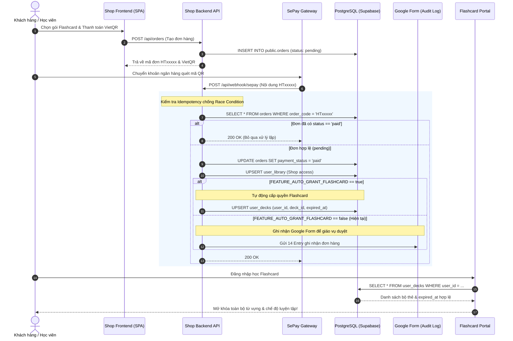

# TÀI LIỆU KIẾN TRÚC: TỰ ĐỘNG HÓA KÍCH HOẠT FLASHCARD
## FLASHCARD & SHOP COMMERCE INTEGRATION SPECIFICATION (AUTO-GRANT PIPELINE)

> **Mã định danh:** `SPEC-ARCH-001`  
> **Trạng thái:** Sẵn sàng triển khai (Ready for Target Implementation)  
> **Mục tiêu:** Đặc tả toàn bộ luồng tích hợp tự động giữa phân hệ Shop (đơn hàng thanh toán thành công) và phân hệ Flashcard (cấp quyền truy cập bộ thẻ trong `public.user_decks`), thay thế quy trình duyệt thủ công qua Google Form.

---

## 1. TỔNG QUAN KIẾN TRÚC & MỤC TIÊU (BACKGROUND & OBJECTIVES)

Hiện tại, quy trình thanh toán và kích hoạt gói học Flashcard đang vận hành theo cơ chế bán tự động:
1. Học viên mua gói Flashcard trên Shop (`shop.huytutor.edu.vn`).
2. SePay/PayPal gửi Webhook thanh toán thành công.
3. Backend Shop lưu đơn hàng `paid` và gửi 14 trường thông tin (entry) vào Google Form nội bộ.
4. Giáo vụ/Quản trị viên đọc Google Form và mở giao diện Admin Flashcard (`flashcard.huytutor.edu.vn/admin/users`) để thêm bộ thẻ (`user_decks`) thủ công bằng tay.

**Mục tiêu kiến trúc tự động hóa:**
- Tự động hóa 100% thời gian thực (Zero-touch fulfillment).
- Khi Webhook xác nhận đơn hàng `paid`, hệ thống tự động tính toán thời hạn (`expired_at`) và chèn bản ghi vào bảng `public.user_decks`.
- Khách hàng đăng nhập vào Flashcard là có thể học ngay lập tức mà không cần chờ đợi phê duyệt thủ công.

---

## 2. SƠ ĐỒ TUẦN TỰ LUỒNG DỮ LIỆU (SEQUENCE DIAGRAM)



---

## 3. BẢNG ÁNH XẠ GÓI SẢN PHẨM SANG BỘ THẺ (PACKAGE TO DECK MAPPING CONTRACT)

Hệ thống sử dụng bảng ánh xạ chuẩn giữa SKU gói Flashcard tại Shop và các bộ thẻ tương ứng trong `public.decks`:

| SKU Mã gói Shop | Tên gói hiển thị | Phạm vi Bộ thẻ (`deck_id`) | Công thức tính `expired_at` |
| :--- | :--- | :--- | :--- |
| `FC-1M` | Flashcard 1 Tháng (Cơ bản) | Tất cả các Decks thuộc Group THPT hoặc All Active Decks | `NOW() + INTERVAL '30 days'` |
| `FC-3M` | Flashcard 3 Tháng (Tiết kiệm) | Tất cả các Decks thuộc Group THPT hoặc All Active Decks | `NOW() + INTERVAL '90 days'` |
| `FC-1Y` | Flashcard 1 Năm (Chuyên sâu) | Toàn bộ Decks trên hệ thống Flashcard | `NOW() + INTERVAL '365 days'` |
| `FC-LIFE` | Flashcard Vĩnh Viễn (Trọn đời) | Toàn bộ Decks trên hệ thống Flashcard | `NULL` (Không bao giờ hết hạn) |
| `FC-GROUP` | Flashcard Mua Theo Nhóm | Toàn bộ Decks cho Trưởng nhóm + Thêm Quota thành viên nhóm | Theo thời hạn gói nhóm (1 năm hoặc vĩnh viễn) |

---

## 4. QUY TẮC CƠ SỞ DỮ LIỆU & XỬ LÝ GIA HẠN (EXPIRATION & RENEWAL RULES)

1. **Ràng buộc duy nhất:**
   - Bảng `public.user_decks` bắt buộc có ràng buộc duy nhất:
     ```sql
     UNIQUE (user_id, deck_id)
     ```
2. **Xử lý Gia hạn (Extension Logic):**
   - Nếu học viên đang còn hạn gói học cũ và mua thêm gói mới:
     Thời hạn mới phải được cộng dồn tiếp nối vào ngày hết hạn hiện tại, không làm mất ngày học cũ của học viên:
     ```sql
     INSERT INTO public.user_decks (user_id, deck_id, expired_at)
     VALUES ($1, $2, $3)
     ON CONFLICT (user_id, deck_id)
     DO UPDATE SET 
       expired_at = CASE 
         WHEN public.user_decks.expired_at IS NULL THEN NULL -- Đang là vĩnh viễn
         WHEN EXCLUDED.expired_at IS NULL THEN NULL           -- Nâng cấp lên vĩnh viễn
         WHEN public.user_decks.expired_at > NOW() 
           THEN public.user_decks.expired_at + ($4 * INTERVAL '1 day') -- Cộng dồn
         ELSE EXCLUDED.expired_at                                     -- Đã hết hạn, tính từ mốc mới
       END;
     ```

---

## 5. HƯỚNG DẪN KÍCH HOẠT KHI 2 BÊN HOÀN THIỆN ĐỒNG BỘ DỮ LIỆU

Khi bộ phận nội dung Flashcard đã cấu hình đầy đủ `id` của các bộ thẻ trên production:
1. Thêm biến môi trường vào `shop/app/api/.env`:
   ```env
   FEATURE_AUTO_GRANT_FLASHCARD=true
   FLASHCARD_DEFAULT_DECK_IDS=uuid-deck-1,uuid-deck-2
   ```
2. Kiểm tra log Webhook: Đơn hàng Flashcard sẽ tự động chèn vào `public.user_decks` ngay khi thanh toán thành công.
3. Google Form vẫn có thể tiếp tục nhận dữ liệu song song như một kênh sao lưu dữ liệu đối soát kế toán.
